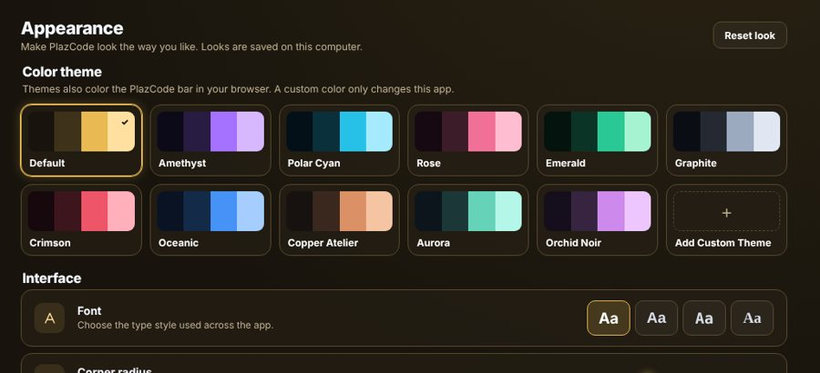

Öffne **Einstellungen > Darstellung**.

## Farbdesigns
Wähle ein Muster. Mit **Add Custom Theme** wählst du deine eigene Farbe.

## Persönlich anpassen
Ändere Schrift, Eckenrundung, Rahmenstärke und Rahmenfarbe, schalte den Regenbogenrahmen ein oder zeige ein dezentes Raster.

## Hintergrundbild
Klicke auf **Choose file** und wähle ein Bild, ein GIF oder ein kurzes MP4- oder WebM-Video. Mit **Wallpaper strength**, **Panel blur** und **Panel opacity** bleiben die Karten auf dem Hintergrund gut lesbar.

> Die Stile werden auf diesem Computer gespeichert. Designs färben auch die PlazCode-Leiste im Browser; eigene Farben und Hintergründe ändern nur die App.
